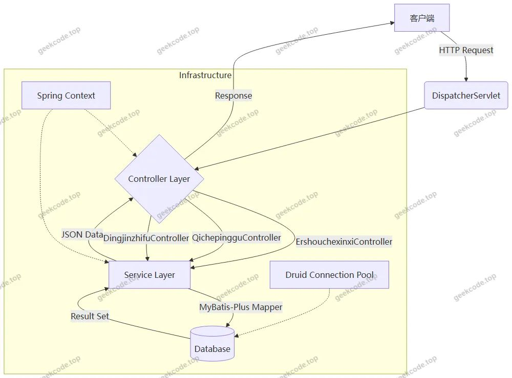
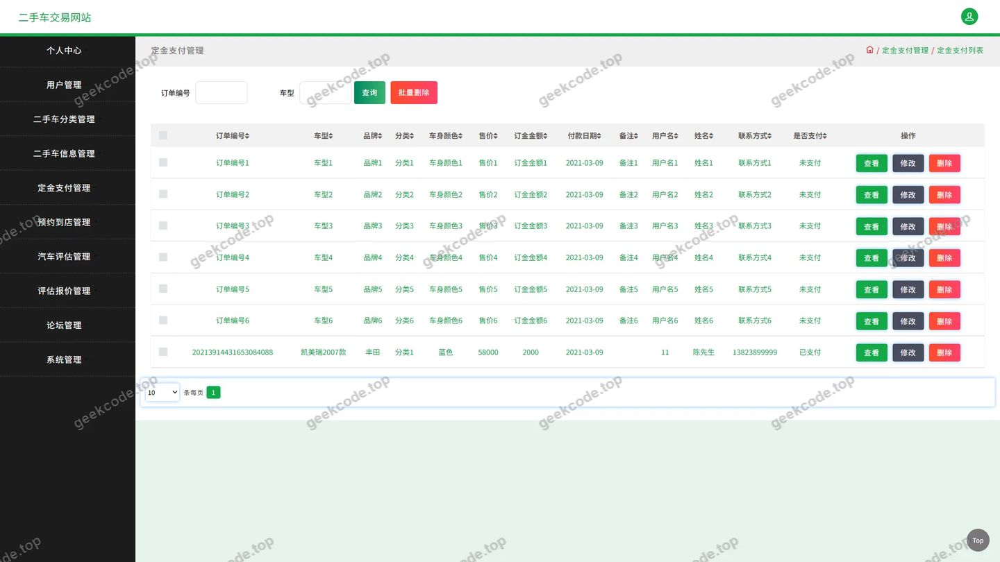
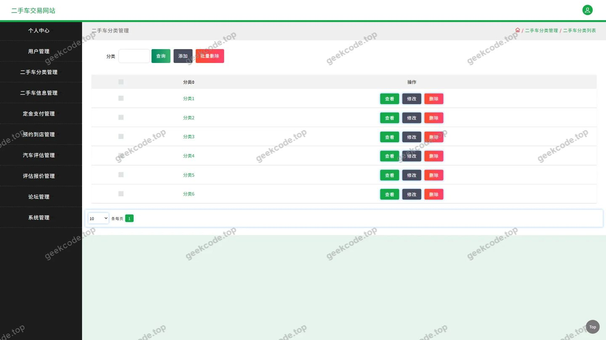
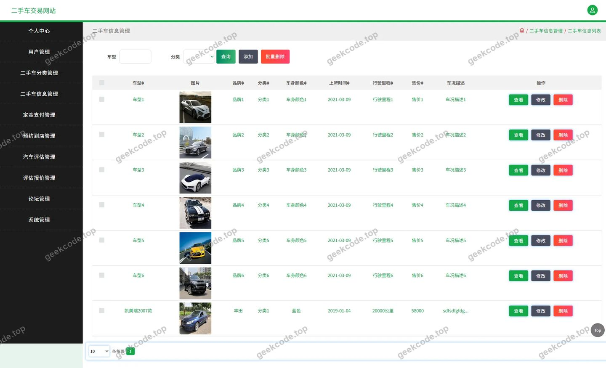
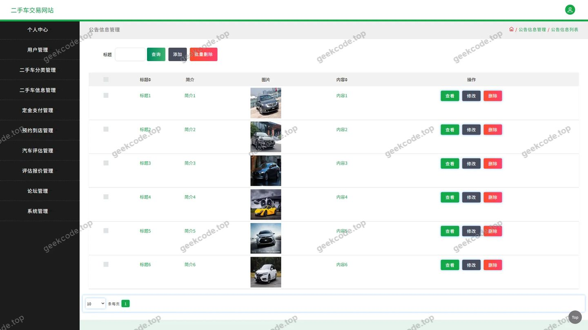
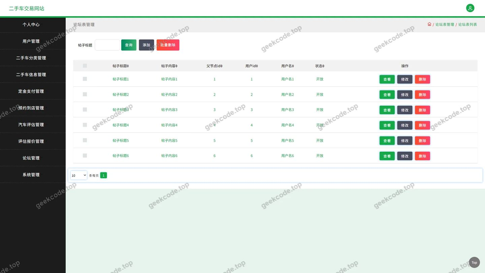
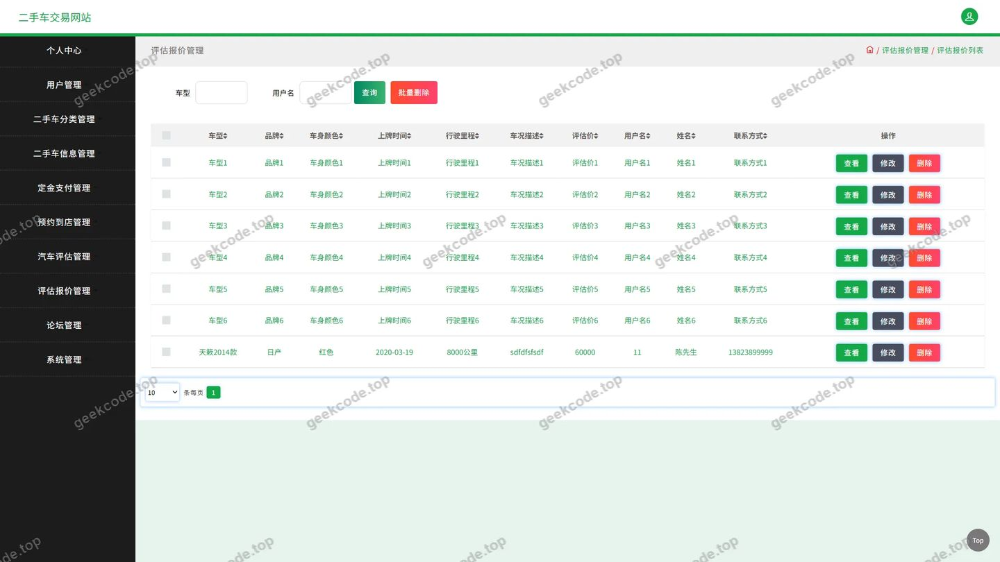
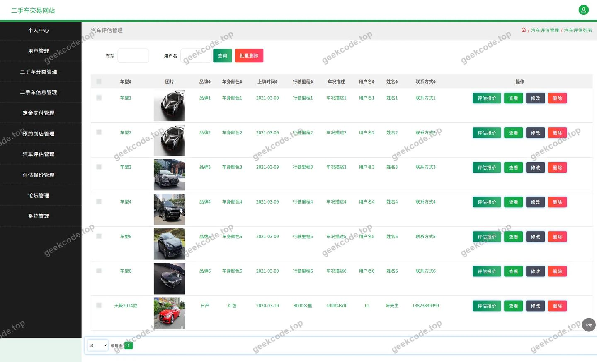
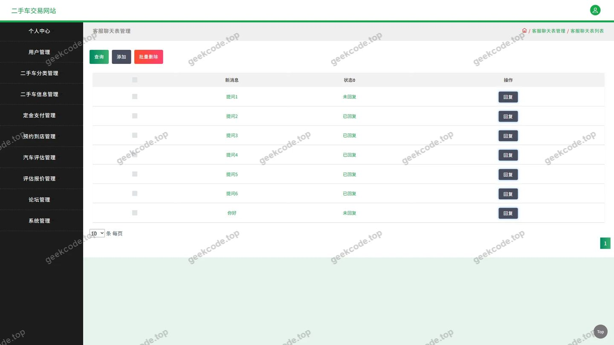

# 二手车交易网站

> 🎓 **计算机毕业设计 · 二手车交易网站**
>
> 本仓库只放**项目介绍 + 运行截图**（截图是站点带水印的原图，存在仓库 `images/` 里）。
>
> 👉 **完整可运行源码 / 数据库脚本 / 部署文档：[点我获取](https://geekcode.top/archives/%E4%BA%8C%E6%89%8B%E8%BD%A6%E4%BA%A4%E6%98%93%E7%BD%91%E7%AB%99?utm_source=github)**
>
> 💬 咨询微信：**ir9372**　|　🌐 更多项目：[极客代码 geekcode.top](https://geekcode.top/?utm_source=github)
>
> 📌 项目详情页：<https://geekcode.top/archives/%E4%BA%8C%E6%89%8B%E8%BD%A6%E4%BA%A4%E6%98%93%E7%BD%91%E7%AB%99?utm_source=github>

<table><td width="230" align="center"> <b>扫码加微信 ir9372</b></td><td valign="middle">📦 源码 = 项目介绍 + 全部运行截图 + 数据库 + 部署文档 👉 点上方任意截图，直接跳到 <b>极客代码 geekcode.top</b> 详情页</td></table>

---

<h1>二手车交易网站</h1>
<h2>项目概述</h2>

本项目为“二手车交易网站”后端服务系统，旨在构建一个高效、稳定的二手车信息管理与交易平台核心接口层。项目聚焦于数据交互与业务逻辑处理，通过提供标准化的 API 接口，支撑前端应用对二手车展示、分类检索、在线评估报价、定金支付及社区论坛等核心业务的访问需求。

系统采用 Spring Boot 框架构建，结合 MyBatis-Plus 实现持久层操作，利用 Druid 连接池优化数据库性能。核心功能涵盖用户认证、车辆信息管理、汽车价值评估模型接口、交易定金流程以及资讯与论坛互动模块。该项目主要服务于需要快速搭建二手车垂直领域平台开发团队或作为计算机专业毕业设计原型，其纯 API 架构设计使得前后端分离部署成为可能，具备良好的扩展性与维护性，适用于移动端 App、Web 端等多终端接入场景。

<h2>技术架构</h2>
<h3>1. 整体架构设计</h3>

本项目采用典型的 B/S 架构下的后端服务模式，遵循分层设计原则，将系统划分为表现层（Controller）、业务逻辑层（Service）和数据访问层（DAO/Mapper）。由于项目定义为 <code>pure-api</code> 且无内置前台/后台路由配置，所有请求均通过 RESTful 风格的 HTTP 接口进行处理，最终返回 JSON 格式数据供客户端解析。

<h3>2. 核心技术选型</h3>
<ul>
<li><strong>基础框架</strong>：基于 Spring Framework 生态体系，使用 <code>spring-core</code>, <code>spring-context</code>, <code>spring-webmvc</code> 等模块构建 IoC 容器和 MVC 控制器。Spring Boot 的自动配置特性简化了启动流程。</li>
<li><strong>持久层框架</strong>：选用 <strong>MyBatis-Plus</strong>。作为 MyBatis 的增强工具，它在 MyBatis 的基础上只做增强不做改变，提供了通用的 CRUD 操作接口，极大减少了 XML 配置文件和 Java 代码的冗余，提高了开发效率。</li>
<li><strong>数据库连接池</strong>：集成 <strong>Druid</strong>。阿里巴巴开源的数据库连接池不仅具备高性能的连接管理功能，还内置了强大的监控统计能力，能够实时查看 SQL 执行状态、连接池使用情况，便于排查性能瓶颈。</li>
<li><strong>事务管理</strong>：依赖 <code>spring-tx</code> 模块，通过声明式事务注解（如 <code>@Transactional</code>）保证关键业务（如订单创建、支付回调）的数据一致性。</li>
</ul>
<h3>3. 数据交互流程</h3>

客户端发起 HTTP 请求 -&gt; Controller 接收参数并校验 -&gt; Service 执行业务逻辑（涉及 MyBatis-Plus Mapper 进行数据库读写） -&gt; 封装结果对象 -&gt; 序列化为 JSON 返回给客户端。

<h2>功能模块</h2>

根据源码中的 Controller 列表及截图所示的功能页面，本项目的后端接口主要划分为以下六大核心模块：

<h3>1. 用户与权限模块</h3>

对应 <code>CommonController</code> 及部分通用接口。

<ul>
<li><strong>登录注册</strong>：提供用户身份验证接口，支持账号密码校验，生成会话令牌或 Cookie 以维持登录状态。</li>
<li><strong>个人中心</strong>：获取当前登录用户的详细信息，包括昵称、头像、联系方式等基础资料。</li>
</ul>
<h3>2. 二手车信息管理模块</h3>

对应 <code>ErshouchexinxiController</code> 和 <code>ErshouchefenleiController</code>。

<ul>
<li><strong>车辆发布与管理</strong>：支持用户提交二手车详细信息（品牌、型号、年份、里程、价格、车况描述等），并提供修改、删除接口。</li>
<li><strong>分类检索</strong>：提供多级分类树查询接口，支持按品牌、车型类别筛选车辆。</li>
<li><strong>车辆详情展示</strong>：根据 ID 获取单辆车的完整图文信息。</li>
</ul>
<h3>3. 汽车评估与报价模块</h3>

对应 <code>QichepingguController</code> 和 <code>PinggubaojiaController</code>。

<ul>
<li><strong>在线评估</strong>：接收用户输入的车辆基本信息，调用后端评估算法或规则引擎，返回预估市场价值。</li>
<li><strong>报价记录</strong>：存储历史评估结果，支持用户查询过往的报价记录，便于对比分析。</li>
</ul>
<h3>4. 交易与支付模块</h3>

对应 <code>DingjinzhifuController</code>。

<ul>
<li><strong>定金支付</strong>：处理购车意向金的下单与支付状态更新接口。该模块通常与第三方支付网关对接，负责记录支付流水、验证签名及更新订单状态。</li>
</ul>
<h3>5. 社区与资讯模块</h3>

对应 <code>ForumController</code> 和 <code>NewsController</code>。

<ul>
<li><strong>论坛互动</strong>：提供发帖、回帖、点赞等社交功能接口，支持“我的发布”和“我的收藏”列表查询。</li>
<li><strong>新闻资讯</strong>：管理行业新闻、政策解读等内容，提供列表分页查询及详情阅读接口。</li>
</ul>
<h3>6. 系统配置与文件模块</h3>

对应 <code>ConfigController</code> 和 <code>FileController</code>。

<ul>
<li><strong>全局配置</strong>：读取系统运行所需的动态配置参数（如轮播图链接、公告栏内容）。</li>
<li><strong>文件上传</strong>：提供图片、文档等非结构化数据的上传接口，用于车辆照片、用户头像等资源存储。</li>
</ul>
<h2>用户角色与权限</h2>

鉴于项目为 <code>pure-api</code> 类型且未包含独立的后台管理路由界面，权限控制主要体现在 API 接口的访问鉴权上。根据业务逻辑推断，系统主要存在以下两类角色：

<h3>1. 普通用户 (Regular User)</h3>
<ul>
<li><strong>定义</strong>：在平台注册并完成认证的自然人，包括买家和卖家。</li>
<li><strong>可访问功能模块</strong>：</li>
<li><strong>浏览类</strong>：二手车信息列表、详情页、分类筛选、新闻资讯、论坛帖子浏览。</li>
<li><strong>个人操作类</strong>：</li>
<li><strong>个人中心</strong>：查看和修改个人资料。</li>
<li><strong>我的发布</strong>：管理自己发布的二手车信息（增删改查）。</li>
<li><strong>我的收藏</strong>：查看收藏的车辆或文章。</li>
<li><strong>汽车评估</strong>：发起新的车辆估价请求，查看自己的历史报价。</li>
<li><strong>论坛互动</strong>：发表新帖、回复评论、点赞。</li>
<li><strong>交易操作</strong>：针对感兴趣车辆发起定金支付申请，查看支付状态。</li>
</ul>
<h3>2. 管理员 (Administrator)</h3>
<ul>
<li><strong>定义</strong>：负责平台运营维护的人员。虽然前端无独立后台页面，但后端接口必然包含高权限的管理操作。</li>
<li><strong>可访问功能模块</strong>：</li>
<li><strong>内容审核与管理</strong>：</li>
<li><strong>二手车信息</strong>：下架违规车辆、审核新发布的车源。</li>
<li><strong>论坛信息</strong>：删除不良言论、置顶优质帖子、封禁违规用户。</li>
<li><strong>新闻资讯</strong>：发布、编辑、删除官方新闻公告。</li>
<li><strong>系统管理</strong>：</li>
<li><strong>用户管理</strong>：重置密码、冻结账号、查看用户列表。</li>
<li><strong>配置管理</strong>：修改系统全局参数（如首页推荐位、广告位）。</li>
<li><strong>数据监控</strong>：查看所有订单记录、评估数据统计、财务流水。</li>
</ul>

<em>注：具体权限粒度由后端拦截器或过滤器根据 Token 中的 Role 字段进行判定，非授权角色访问管理类接口将返回 403 Forbidden 错误。</em>

<h2>项目特色与创新点</h2>
<ol>
<li>
<strong>前后端彻底解耦的 API 优先设计</strong>
   项目严格遵循 <code>pure-api</code> 模式，不包含任何服务器端渲染页面（JSP/Thymeleaf 等）。这种设计使得后端专注于业务逻辑与数据处理，前端可以灵活选择 Vue.js、React 或原生 Android/iOS 进行开发，极大地提升了系统的可维护性和多端适配能力。

</li>
<li>
<strong>集成化的汽车价值评估服务</strong>
   区别于传统的静态信息展示网站，本项目引入了 <code>QichepingguController</code> 和 <code>PinggubaojiaController</code>，实现了从“信息展示”到“价值量化”的功能延伸。通过后端算法接口提供即时报价参考，增强了用户在交易前的决策信心，体现了数据驱动的业务创新。

</li>
<li>
<strong>高性能的数据访问层优化</strong>
   采用 MyBatis-Plus 替代传统 MyBatis，大幅降低了样板代码量；配合 Druid 连接池，不仅保证了高并发下的数据库连接稳定性，还提供了详尽的 SQL 监控指标。这种组合在保证开发效率的同时，兼顾了生产环境的运维可观测性。

</li>
<li>
<strong>闭环的交易辅助流程</strong>
   通过 <code>DingjinzhifuController</code> 引入定金支付环节，构建了从“看车”、“估价”到“锁定意向”的完整业务闭环。这不仅模拟了真实二手车交易中的信任建立机制，也为后续可能的线上签约、物流跟踪等高级功能预留了接口扩展空间。

</li>
</ol>
<h2>部署环境</h2>

为确保项目正常运行，需准备以下软件及硬件环境：

<table>
<thead>
<tr>
<th align="left">组件</th>
<th align="left">版本要求</th>
<th align="left">说明</th>
</tr>
</thead>
<tbody><tr>
<td align="left"><strong>操作系统</strong></td>
<td align="left">Windows 10/11, Linux (CentOS 7+), macOS</td>
<td align="left">建议生产环境使用 Linux</td>
</tr>
<tr>
<td align="left"><strong>JDK</strong></td>
<td align="left">JDK 8 或 JDK 11</td>
<td align="left">Spring Boot 2.x 系列通常兼容 JDK 8，具体视 pom.xml 而定</td>
</tr>
<tr>
<td align="left"><strong>构建工具</strong></td>
<td align="left">Maven 3.6+</td>
<td align="left">用于依赖管理和项目打包</td>
</tr>
<tr>
<td align="left"><strong>数据库</strong></td>
<td align="left">MySQL 5.7 或 MySQL 8.0</td>
<td align="left">需初始化表结构，建议使用 utf8mb4 字符集</td>
</tr>
<tr>
<td align="left"><strong>中间件</strong></td>
<td align="left">Redis (可选)</td>
<td align="left">若项目涉及缓存或 Session 共享，可能需要安装</td>
</tr>
<tr>
<td align="left"><strong>IDE</strong></td>
<td align="left">IntelliJ IDEA 或 Eclipse</td>
<td align="left">开发调试使用</td>
</tr>
</tbody></table>

<strong>部署步骤简述：</strong>

<ol>
<li>安装 JDK 并配置环境变量。</li>
<li>安装 MySQL 服务，创建数据库 <code>used_car_db</code>，导入项目提供的 <code>.sql</code> 初始化脚本。</li>
<li>修改项目配置文件（如 <code>application.yml</code> 或 <code>application.properties</code>），填入正确的数据库 URL、用户名和密码。</li>
<li>使用 Maven 命令 <code>mvn clean package -DskipTests</code> 编译打包，生成 <code>.jar</code> 文件。</li>
<li>通过命令行 <code>java -jar target/project-name.jar</code> 启动服务。</li>
<li>使用 Postman 或 curl 工具测试 API 接口连通性。</li>
</ol>
<h2>五、技术特性</h2>
<ul>
<li>使用 MyBatis-Plus 简化数据访问层开发</li>
</ul>
<h2>六、功能模块截图</h2>
<h3>后台管理端</h3>
<h4>页面-登录</h4>

<h4>页面-定金支付</h4>

<h4>页面-二手车分类</h4>

<h4>页面-二手车信息</h4>

<h4>页面-公告信息</h4>

<h4>页面-论坛</h4>

<h4>页面-评估报价</h4>

<h4>页面-汽车评估</h4>

<h4>页面-用户</h4>

---

## 获取完整源码

| 项目 | 说明 |
| --- | --- |
| 项目名 | 二手车交易网站 |
| 运行截图 | 本文 10 张（站点带水印原图，仓库 `images/` 目录） |
| 完整源码 | [https://geekcode.top/archives/%E4%BA%8C%E6%89%8B%E8%BD%A6%E4%BA%A4%E6%98%93%E7%BD%91%E7%AB%99?utm_source=github](https://geekcode.top/archives/%E4%BA%8C%E6%89%8B%E8%BD%A6%E4%BA%A4%E6%98%93%E7%BD%91%E7%AB%99?utm_source=github) |
| 咨询微信 | **ir9372**（备注：jingpin-yuanma） |
| 更多项目 | [极客代码 geekcode.top](https://geekcode.top/?utm_source=github) |

> 需要源码、部署、改配置、跑不起来等问题，加微信 ir9372 沟通，说明项目名即可。
